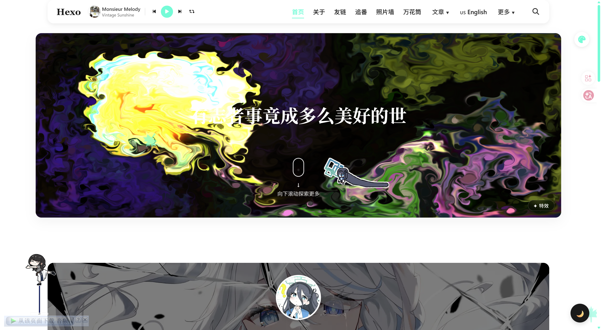
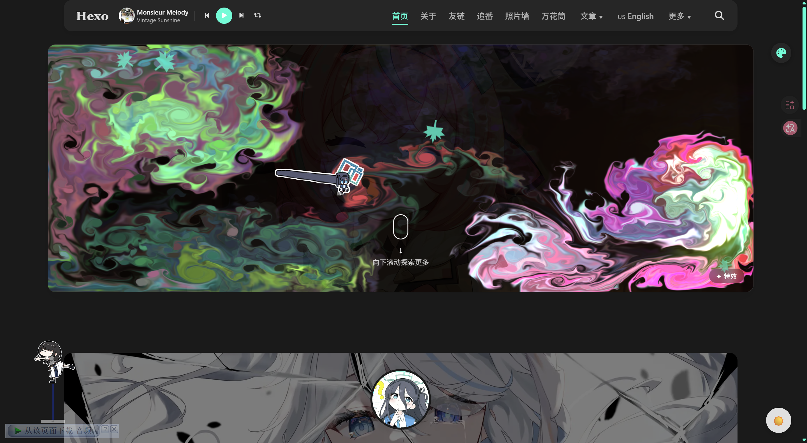
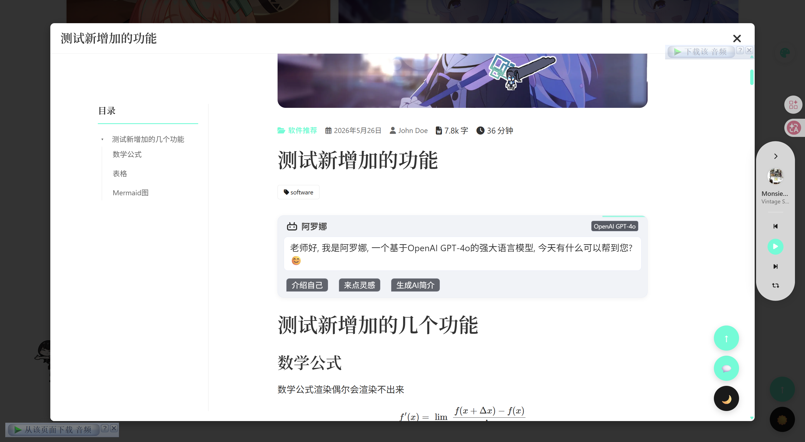
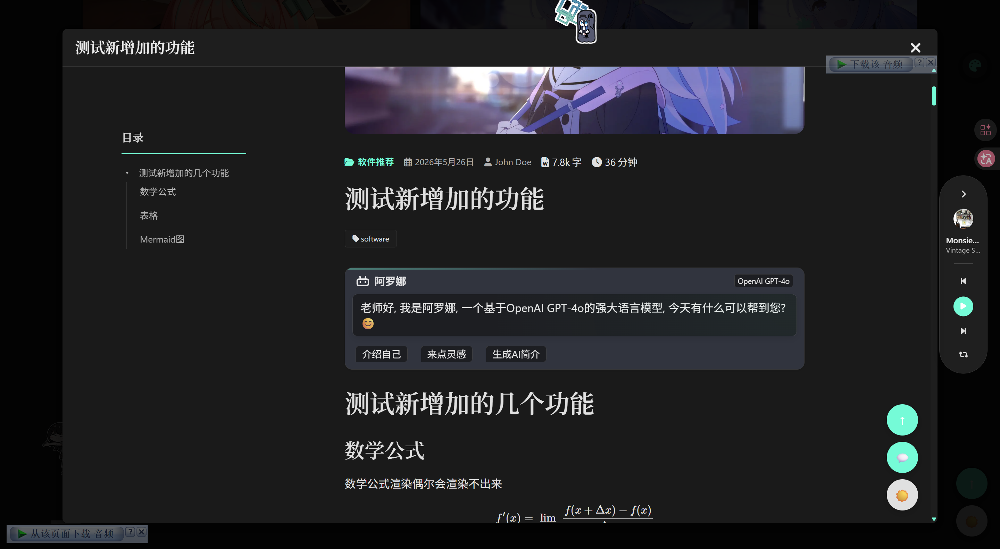
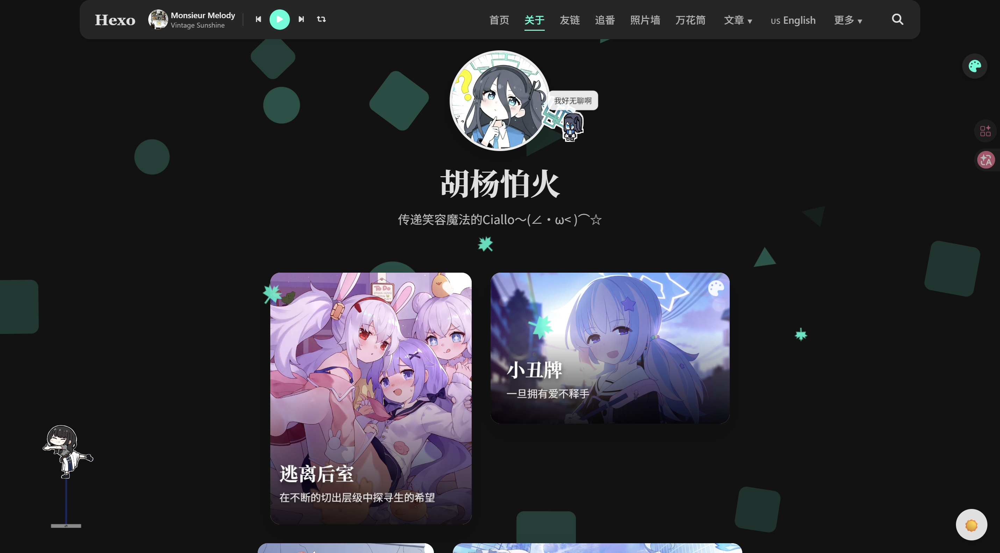
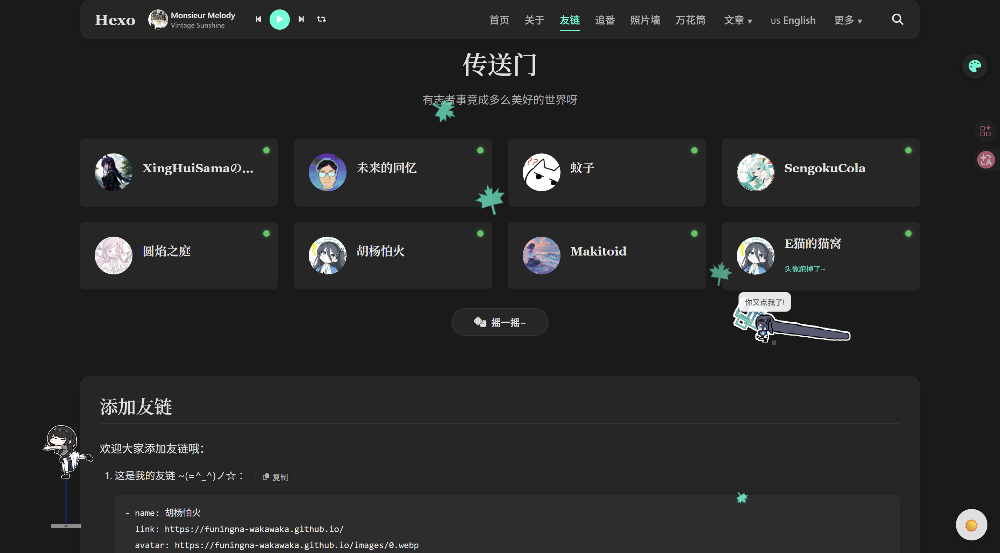
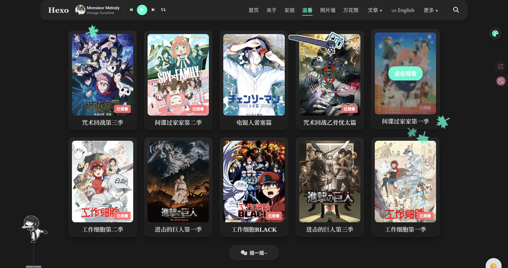
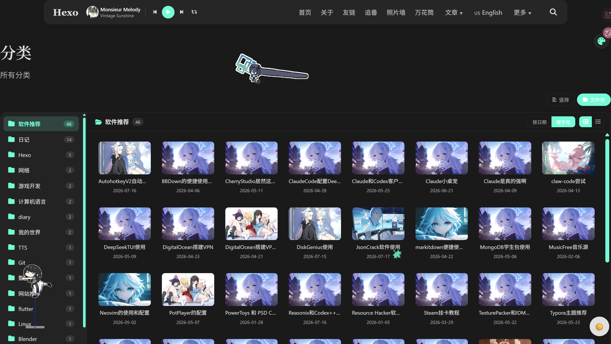
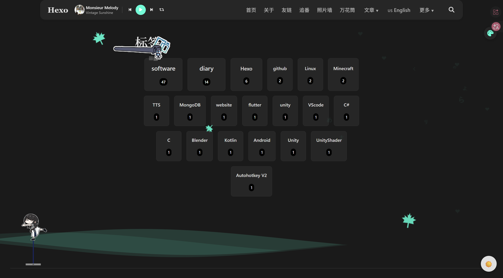
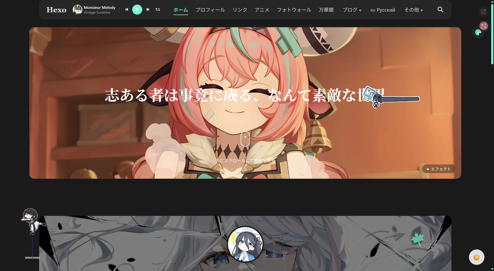

# Magzine 主题

> [!NOTE]
> **请特别注意**
> 本仓库不再更新，本主题是 [forever218](https://github.com/forever218) 的 [magzine 主题](https://github.com/forever218/hexo-theme-magzine)的分支版本。
>
> 不过由于技术债和历史遗留问题还有先前我不合理的设计导致我一直在用agent打补丁，每一次决策都要消耗巨大的精力😭
>
> 我决定用typescript和其他技术重写，不再在原项目上操作了，此版本为最后一个稳定版本

一款现代化的杂志风格 Hexo 主题:大屏支持、简洁优雅,内置桌宠、Sakana 小人、
评论、AI 摘要、音乐播放器、首页 WebGL 特效等大量可开关组件,并做了深度的
性能优化(构建期图片压缩/WebP、按视口渲染、rAF 合帧交互)。

**多语言**:中 / 英 / 日 / 俄 四套界面随语言文件自动切换,新增语言只需加一份 yml。

[主题文档 docs/](docs/README.md)

## 预览

查看我的[博客](https://desertpoplar.com/)

### 明暗双态

| 亮色模式 · 主页 | 暗色模式 · 主页 |
|---|---|
|  |  |

| 亮色模式 · 文章页 | 暗色模式 · 文章页 |
|---|---|
|  |  |

### 独立页面

| 关于页 | 友链页 |
|---|---|
|  |  |

| 追番页 | 分类页 |
|---|---|
|  |  |

| 标签页 | 多语言界面 |
|---|---|
|  |  |

## 主要特性

- **多语言**:中/英/日/俄 界面实时切换,内容字段(`title_en`…)、日期格式、
  AI 回复语言全部跟随;新增语言 = 新增一份 `language/xx.yml`
- **性能**:构建期路由流图片压缩/WebP(引用自动改写,一次构建即生效)、
  全站脚本 defer、评论/图表/公式按视口懒加载、离屏内容跳过渲染
- **首页特效**:流体模拟与水彩光晕(WebGL),可扩展框架 + 可视化调参面板
  (特效面板支持快捷键收起、参数持久化、离屏自动暂停)
- **代码块 v2**:深浅自适应卡片、行号、复制、折叠、滚轮横滑、语言标签
- **查看器三件套**:图片 / 表格 / Mermaid 全屏查看,1:1 拖拽跟手 + 惯性 + 橡皮筋
- **桌宠**:状态机 AI、发丝物理、文字避让(视口懒包裹,长文不卡)、
  内置迷你音乐播放器、右键菜单
- **组件**:Sakana 小人、动态光标、落叶 / 点击特效、调色盘、本地搜索、
  RSS、pjax 无感刷新、读者设置面板(右键)
- **内容标签**:按钮 / 图片 / 轮播 / 折叠 / 提示 / 隐藏 / 徽章 / 选项卡 /
  时间线 / 视频(点击加载门面,不自动播放)
- **AI 摘要**:内置"阿罗娜"面板,提示词随语言变化,AI 用当前界面语言作答

## 安装

1. 将主题克隆或下载到 Hexo 项目的 `themes` 目录:

```bash
git clone https://github.com/huyangpahuo/magzine-branch.git themes/magzine
```

2. 修改 Hexo 站点的 `_config.yml`:

```yaml
theme: magzine
```

3. 安装依赖(`npm install`),确保 `package.json` 包含:

```json
"hexo": "^8.0.0",
"hexo-generator-archive": "^2.0.0",
"hexo-generator-category": "^2.0.0",
"hexo-generator-feed": "^4.0.0",
"hexo-generator-index": "^4.0.0",
"hexo-generator-search": "^2.4.3",
"hexo-generator-tag": "^2.0.0",

"hexo-renderer-ejs": "^2.0.0",
"hexo-renderer-marked": "^7.0.0",
"hexo-renderer-pug": "^3.0.0",
"hexo-renderer-stylus": "^3.0.1",
"hexo-server": "^3.0.0",
"hexo-util": "^3.3.0"
```

### 增强插件

| 插件 | 功能 |
| --- | --- |
| `hexo-wordcount` | 文章字数统计 / 阅读时长 |
| `hexo-generator-search` | 站内搜索 |
| `hexo-filter-mermaid-diagrams` | Mermaid 图表 |
| `sharp` | 构建期图片压缩/WebP(配合主题 `compress_images` 配置) |
| `hexo-generator-feed` | RSS 订阅 |
| `hexo-asset-img` `hexo-image-link` | 使用 img 标签插入图片 |

#### ① 图片自动压缩 / WebP

主题在构建期自动完成压缩与 WebP 转换,引用自动改写:

```bash
hexo clean && hexo generate   # 一次即可;hexo server 预览同为压缩后效果
```

出现以下内容即成功:

```bash
🖼 [Image Compressor] webp 模式:807 张图片输出时转为 webp,文本引用自动改写
```

详见 [docs/图片压缩与工作流指南](docs/图片压缩与工作流指南.md)。

#### ② 搜索功能

Hexo 根目录 `_config.yml` 底部添加:

```yaml
search:
  path: search.json
  field: post
  content: true
  format: html
```

#### ③ Mermaid 图表

```yaml
mermaid:
  enable: true
  version: "10.6.1"
```

#### ④ 使用 img 标签插入图片

```yaml
post_asset_folder: true
marked:
  prependRoot: true
  postAsset: true
relative_link: false
```

也可用 hexo 自带方式,见[官方文档](https://hexo.io/zh-cn/docs/asset-folders)。

#### ⑤ RSS 订阅

```yaml
feed:
  type: atom
  path: atom.xml
  limit: 20
  order_by: -date
```

⚠️ 请把根目录 `_config.yml` 的 `url` 改为真实站点地址,否则订阅源里的链接是错的


## 多语言(key 驱动运行时翻译层)

页面始终由 Hexo 以中文渲染,浏览器端只对**显式标记**的界面词条换语言,
不做整页文本扫描——文章正文、标题、标签、分类、歌名、番剧名等内容永不误翻。

```
language/
├── zh.yml    基准字典,页面文案的唯一来源(键 = 词条 ID,值 = 中文文案)
├── en.yml    英文
├── ja.yml    日文
└── ru.yml    俄文(顶层 _meta 提供按钮用的国旗与名称)
```

- 模板用 `zh('词条ID')` 渲染中文,JS 用 `i18n.text('词条ID')` 取词;
- 会增删的内容(关于页资料/技能标签、番剧、友链)在 `source/_data/*.yml`
  里逐条维护,自带可选 `*_en/*_ja/*_ru` 字段,不写就显示中文;
- 番剧名与歌名不做翻译;front matter 标题想要译文可写 `title_en`/`title_ja`;
- 语言按钮按语言文件自动循环切换,日期格式与 AI 回复语言跟随当前语言;
- `npm run check:cjk` 扫描模板/脚本里的裸中文,防止绕过词条体系。

**新增一种语言**:复制一份 `en.yml` → 翻译 → 改 `_meta` → `hexo generate`,
不需要改模板或 JS。改 `_config.yml` 里的配置中文(菜单、打字文案等)后,
到 `zh.yml` 对应词条同步一下即可继续被翻译;不改也只是该文案在译语言下
显示中文,不影响其他文本。详见[国际化架构](docs/06-国际化架构.md)。

## 更多文档

完整技术文档位于 [docs/](docs/README.md):架构总览(含图)、逐模块清单、
构建与部署、配置速查、性能设计、国际化架构、首页特效框架、桌宠系统、
内容标签语法。

### 框架与引擎

| 项目 | 用途 |
| --- | --- |
| [Hexo](https://hexo.io/) | 静态博客框架 |
| [Pug](https://pugjs.org/) | 模板引擎 |
| [Stylus](https://stylus-lang.com/) / [marked](https://marked.js.org/) | 样式与 Markdown 渲染(hexo-renderer-*) |
| [highlight.js](https://highlightjs.org/)(经 hexo-util 内置) | 服务端代码高亮 |
| [sharp](https://sharp.pixelplumbing.com/) | 构建期图片压缩/WebP |

### 特效与视觉

| 项目 | 用途 |
| --- | --- |
| [WebGL-Fluid-Simulation](https://github.com/PavelDoGreat/WebGL-Fluid-Simulation) by Pavel Dobryakov | **首页流体模拟特效**(MIT,已适配:透明合成叠加 Hero、取色自背景图、悬停/触摸交互、质量档位) |
| [Shadertoy: lsyfWD](https://www.shadertoy.com/view/lsyfWD) | **首页水彩光晕特效**(着色器思路参考,本地透明画布实现,不依赖远程 iframe/API key) |
| [liquid-refraction-lab](https://github.com/feitangyuan/liquid-refraction-lab) | **开屏封面水波折射背景**(WebGL,已本地化) |
| [Sakana 小人](https://github.com/itorr/sakana) by itorr | 悬挂小人组件(引擎本地化,立绘本地化,摆动参数已调温和) |
| [Font Awesome 6.4.0](https://fontawesome.com/) | 全站图标(已本地化至 `lib/font-awesome/`) |
| [AnyaCursor](https://github.com/Rachit-Pal/AnyaCursor) | 阿尼亚鼠标指针动态光标素材 |
| Inter / Playfair Display / Fira Code | 字体族名称沿用其字体栈设计,实际渲染回退系统字体(Google Fonts 依赖已移除) |

### 设计与实现参考

| 项目 | 用途 |
| --- | --- |
| [rightdoor/citrus-grid](https://github.com/rightdoor/citrus-grid) 的 Astro 博客 | **主题的诸多优化参考了rightdoor大佬的实现**:按视口加载(`client:visible` 思路)、阅读显现动画、部分交互动效与性能取舍思路 |
| [rightdoor/visitor-stats](https://github.com/rightdoor/visitor-stats) | **站点访问统计(PV/UV)服务**:文章卡片徽标与文章页浏览/访客数由它统计(Cloudflare Worker + D1,自建部署;配置见 `_config.yml` 的 `post_stats`) |

### 功能组件与外置服务

| 项目 | 用途 |
| --- | --- |
| [twikoo](https://twikoo.js.org/)(本地化) | 评论区(默认);亦支持 [Disqus](https://disqus.com/)、[Gitalk](https://github.com/gitalk/gitalk)、[Valine](https://valine.js.org/) |
| [MathJax 3](https://www.mathjax.org/)(jsDelivr CDN,按需) | 数学公式 |
| [Mermaid 10](https://mermaid.js.org/)(cdnjs,按视口) | 图表 |
| [QRCode.js](https://github.com/davidshimjs/qrcodejs)(cdnjs,点击时加载) | 微信分享二维码 |
| [Post-Summary-AI](https://github.com/qxchuckle/Post-Summary-AI) by qxchuckle | **文章摘要 AI 生成工具,魔改自该项目**:AI 摘要样式与方案 |
| [ArtPlayer 5.4.0](https://artplayer.org) | **番剧播放器**(追番页视频播放) |
| Bilibili / AcFun / 虎牙等嵌入播放器 | 视频标签(境外平台需读者自备网络) |

### 内容与素材来源

| 来源 | 用途 |
| --- | --- |
| [Bangumi 番组计划](https://bangumi.tv/) | **追番页的番剧封面与角色信息**接口来源 |
| [HAOWALLPAPER](https://haowallpaper.com/) | **站点壁纸图片来源** |
| 哔哩哔哩 **乌龙茶速递** | **桌宠素材与原型**:魔改自《【BA同人游戏】番外-简单摸鱼写的爱丽丝桌宠》([视频 BV1MmdjY3E8r](https://www.bilibili.com/video/BV1MmdjY3E8r)) |
