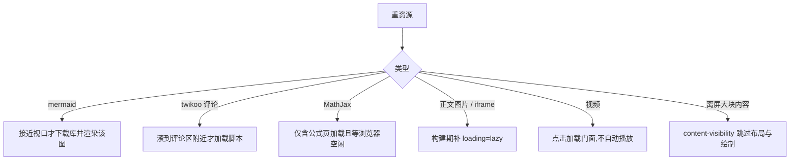
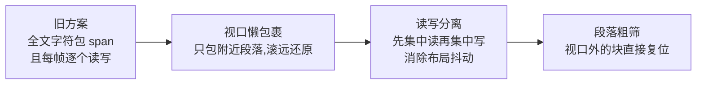
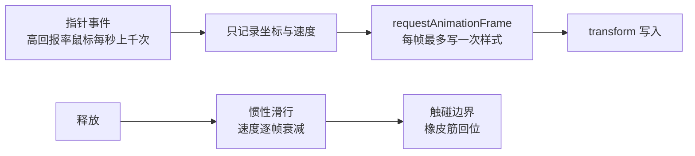

# 05 性能设计

> 记录"为什么这样做",方便二次开发时不小心破坏这些设计。每一条都是踩过坑的结论。

## 一、按视口加载(Astro client:visible 思想的落地)

> 思路参考 [rightdoor/citrus-grid](https://github.com/rightdoor/citrus-grid) 的
> Astro 博客:重资源只在接近视口时才付出成本。



**坑位记录(改前必读)**:

1. `content-visibility` 不能加在带绝对定位装饰的容器上(paint 裁剪会剪掉代码块
   工具栏、mermaid 全屏按钮)——只加在 `.table-wrapper / iframe / video /
   mjx-container / .hexo-video-embed`。
2. `content-visibility` 不能加在需要量高度做决策的元素上(折叠判断会拿到
   320px 估算值)——所以 `.codecard` 没加。
3. 阅读显现动画只作用于**永不被脚本移动的元素白名单**(`p/h1-h6/ul/ol/
   blockquote/hr`);`table.js` 会重排表格、`mermaid.js` 会替换 `pre`,对它们做
   动画会导致"替换后的新元素永远 `opacity:0`"。

## 二、翻译层不做 DOM 扫描,只认标记

早期方案给**整页每个元素**做文本扫描,再把中文原文拿去查表,页面上的 DOM 动画
(打字机、几何漫游、播放器进度、桌宠文字避让)每秒产生成百上千次变更,必须靠
MutationObserver + 150ms 防抖 + 装饰容器跳过名单来"压住"开销,还留下两个隐患:
正文/标签/分类撞上词条会被误翻(如"哔哩哔哩"被译成"ビリビリ"),以及改文案后
字典静默失配。

现方案改为**标记驱动**(见 [06-国际化架构](06-国际化架构.md)):

```
模板/脚本显式标记  →  运行期按标记换文案(不扫 DOM)
  data-i18n-key      界面词条(模板 zh()/t()、JS i18n.set 输出)
  data-i18n-value    配置中文(菜单项/打字文案,经"中文值→词条ID"索引)
  data-i18n-zh + data-i18n-<lang>   数据项显式译文(i18n_attrs 输出)
```

- **零扫描成本**:只有带标记的元素参与,页面上的动画节点天然不在其中,
  不再需要"跳过名单"和防抖队列;
- **内容绝对安全**:正文、标题、标签、分类、歌名没有标记,永远不会被替换;
- **切语言 = 按标记重渲染**:`applyTree` 从属性重新取值(幂等),不基于当前
  DOM 文本推断,来回切换不会出现"二次翻译";
- **动态插入只需补一次套用**:`MutationObserver` 仅监听 `childList`,对新增
  子树执行一次 `applyTree`;JS 侧文案一律在写入时经 `i18n` 取词,不存在
  "先写中文再被纠正"的过渡态;
- **自行生成文案的组件重绘**:`langchange` 事件通知打字机、搜索计数、
  "加载更多"、AI 面板等按当前语言刷新。

**坑位记录**:JS 把内容写进 DOM 时必须同步处理标记——写动态内容(歌名/番剧标题)
要先 `removeAttribute("data-i18n-key")` 摘掉状态词条,否则切语言时会被状态文案
覆盖;写界面文案则要用 `i18n.set(el, key)` 补上标记,否则切语言时不刷新。

## 三、桌宠文字避让的三层优化



实测:长文同时存在的字符 span 从全文字数降到 ~200。

## 四、拖拽手感 = rAF 合帧 + 惯性



**为什么不用 `will-change: transform`**:它会把元素预栅格化成 GPU 纹理,放大
(尤其矢量 SVG)时沿用低分辨率纹理 → 文字模糊。流畅度靠 rAF 合帧已经足够。

## 五、路由流压缩的由来

旧机制扫 `public/` 文件夹,而 Hexo 的 `after_generate` 在写盘**之前**触发,
第一次构建时 `public` 是空的 → 必须连跑两次。路由流方案把转换挂在数据流上,与
输出时机解耦,同时天然覆盖 `hexo server` 预览;server 模式每次请求都会重拉路由流,
所以加了 400MB FIFO 转换缓存(没有它每次刷新都全量重压缩,server CPU 打满、页面
超时——即"模态空白/文字消失"事故的根因)。

## 六、首屏没有的东西

以下都刻意**没有**引入,是首屏体积能保持很小的原因:

| 没有 | 替代方案 |
|---|---|
| 前端框架运行时(React/Vue) | 原生 JS 模块 + 少量全局约定 |
| 打包器与 polyfill | `defer` 顺序加载源文件,浏览器原生 ESM 只用于桌宠 |
| 远程字体(Google Fonts) | 保留字体栈名称,实际回退系统字体 |
| 阻塞式第三方脚本 | 全部本地化(`vendor/`、`lib/`)或按需加载 |
| 每页内联的翻译字典 | 独立可缓存的 `js/core/lang-dict.js` |
| 首屏就渲染的评论/图表/公式 | 按视口或空闲触发 |

## 七、加载顺序约定

1. `<head>` 内联:暗色模式预置(防闪)、iframe 标记 + **iframe 专用隐藏样式**
   (内联而非等异步 CSS,否则模态窗口里的导航栏会闪现约 1 秒)、
   读者设置覆盖样式(防闪);
2. 全站脚本 `defer`(保持文档顺序,`DOMContentLoaded` 前执行完);
   **`lang-dict.js` 与 `lang-switch.js` 排在最前**——`window.i18n` 必须在脚本
   执行期(而非 DOMContentLoaded)就绪,后续组件启动时的取词才不会拿到空值;
3. `window.theme` 配置在脚本之前内联输出,脚本启动零请求;
4. 重资源按视口/空闲触发;
5. pjax 换页重派发 `DOMContentLoaded`,模块以幂等标记防重入
   (`window.__xxx` / `data-xxx` / class 标记);
6. 改完模板/脚本跑 `npm run check:cjk`(见 [02-模块清单](02-模块清单.md)),
   它会拦下裸中文、pug 内嵌 script 块语法错误与注释前缀丢失三类回归。
