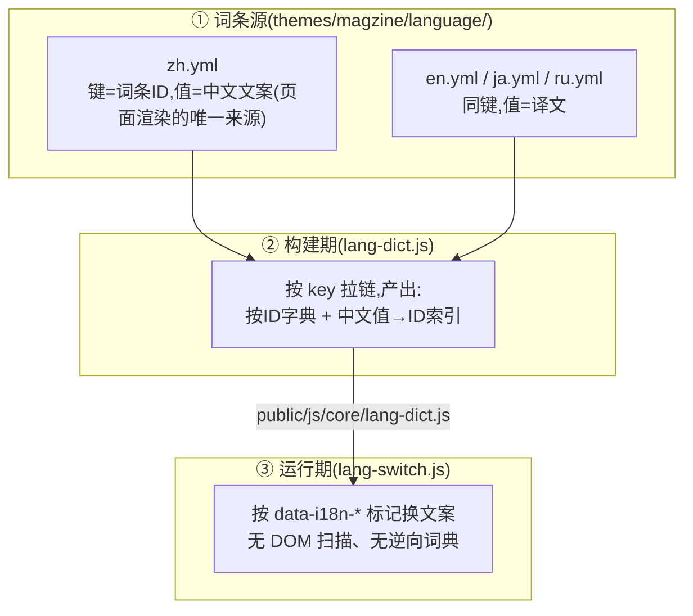

# 06 国际化架构

> 主题采用**运行时翻译层(key 驱动)**方案:页面始终由 Hexo 以中文渲染,
> 浏览器在运行时**按显式标记**把界面文案换成目标语言。
> 翻译层**不做任何 DOM 全页扫描**——没有被标记的文本永远不会被碰。

## 一、核心契约(先读这个)

| 规则 | 说明 |
|---|---|
| zh.yml 是唯一文案源 | 模板写 `zh('键')` 渲染中文,JS 写 `i18n.text('键')` 取词;模板/JS 里禁止硬编码中文界面文案 |
| 运行期按标记换文案 | 只有带 `data-i18n-*` 通道标记的元素参与翻译;切语言 = 整树按标记重渲染(幂等) |
| 内容永不翻译 | 文章正文、标题、标签、分类、歌名、番剧名都是内容;撞上任何词条也不会被替换 |
| `npm run check:cjk` | 扫描模板/脚本里的裸中文,查漏与防回归 |

三个历史问题就此根治:正文撞词条被误翻(哔哩哔哩→ビリビリ)、改文案后字典静默失配、
其他使用者把主题装到自己博客后内容被劫持。

## 二、三层结构



每一节词条都标注了使用它的模板/脚本(见 zh.yml 内的分节注释);反过来在模板里
看到 `zh('xxx')` / `i18n.get('xxx')`,到 zh.yml 搜键名即可。

## 三、四个通道(运行期只认这些标记)

| 通道 | 标记 | 用法 | 适用 |
|---|---|---|---|
| 键通道(文本) | `data-i18n-key` | `span&attributes(t('toc.title'))= zh('toc.title')` | 界面词条 |
| 键通道(属性) | `data-i18n-key-<attr>` | `input&attributes(ta('placeholder','search.placeholder'))` | placeholder/aria-label/data-title/alt 等 |
| 值通道 | `data-i18n-value`(+`-<attr>` 变体) | `span(data-i18n-value=theme.footer.copyright)` | **会改的配置中文**:菜单项、打字文案、封面文案、版权、作者名/简介 |
| 显式属性通道 | `data-i18n-zh` + `data-i18n-<lang>`(及 `<attr>` 变体) | `i18n_attrs(item, 'title')` 助手输出 | **数据文件里逐条维护的内容译文**:关于页卡片、友链名/描述 |

取值优先级:显式属性 > 键 > 值;非中文模式下,当前语言缺译回退英文,再回退中文,绝不空白。

### 值通道的约定

配置中文(`_config.yml` 的 `theme.menu`、`hero.typing_text`、`cover.*`、
`footer.copyright`、`author_card.*`)经"中文值 → 词条ID"索引翻译,因此:

- 想让某条配置文案被翻译,在 zh.yml 的对应分节(nav.* / hero.* / site.* …)
  放一条**与配置文案一字不差**的词条即可;
- 匹配不到就原样显示中文,不报错、不影响别处;
- 同一中文值对应多条词条时构建日志警告,按先注册的键翻译。

**在 config.yml 里改了中文会怎样?** zh.yml 不会覆盖 config.yml——两者是
不同通道:界面词条由 zh.yml 渲染(config 不参与),配置文案由 config.yml
渲染、zh.yml 只充当它的译文表。所以改配置中文后:

1. 页面正常显示新中文(渲染源就是配置本身);
2. 该文案在译语言下回落显示中文——因为值索引里匹配的还是旧文案;
3. 把 zh.yml 对应词条的值同步成新文案,翻译即恢复;
4. 无论改不改,都不会影响其他文本的翻译(索引只做精确匹配)。

### 数据文件的逐条译文(词条会增删的内容)

关于页资料/技能标签(`source/_data/about.yml` 的 `profile`/`skills`)、
友链(`link.yml`)、兴趣卡片(`about.yml` 的 `cards`)都是**会增删的条目**:
每条自带可选 `_en/_ja/_ru` 字段,不写就显示中文。**增删条目不需要动字典和模板。**

```yaml
# source/_data/about.yml
profile:
  - label: 称呼
    label_en: Name
    label_ja: 名前
    value: 胡杨怕火
    value_en: Huyangpahuo
```

模板侧由 `i18n_attrs(item, 'value')` / `i18n_attrs(item, 'label', 'data-label')`
自动展开成 `data-i18n-*` 属性。新增语言时这些通道自动跟随(助手扫描 language/ 目录)。

## 四、JS 侧 API(window.i18n)

| API | 用途 |
|---|---|
| `i18n.get(keyOrZh)` | 词条ID或配置中文 → 当前语言文案;中文模式原样返回 |
| `i18n.text(key)` | 纯词条ID取词;中文模式解析 zh.yml 规范文案(JS 建议都用它) |
| `i18n.format(key, vars)` | 带 `{n}`/`{t}` 占位符的词条 |
| `i18n.set(el, key)` / `i18n.setAttr(el, attr, key)` | 动态创建的元素:打标记 + 立即填当前语言,切语言时随 applyTree 刷新 |
| `i18n.applyLanguage(lang)` | 原地切换(幂等);语言按钮即调用它 |
| `i18n.translateNode(el)` | 手动对插入的子树套用通道 |
| `i18n.translateDates()` | 按当前语言刷新日期 |
| `i18n.lang()/langs()/isEn()` | 状态查询 |

约定:JS 里**凡是写进 DOM 的界面文案,写入时同步打 key 标记**
(`i18n.set` 或手动 `setAttribute('data-i18n-key', key)`),语言切换才能一并刷新。
反过来,写入**动态内容**(歌名、番剧标题、搜索结果标题)时,要先
`removeAttribute('data-i18n-key')` 摘掉状态词条(见 music-player.js loadSong 的注释)。

组件若自行生成文案(打字机、搜索计数等),监听 `langchange` 事件重绘。

## 五、内容豁免清单(有意不翻译)

| 内容 | 处理方式 |
|---|---|
| 文章正文、TOC 条目 | 无标记,永不参与 |
| front matter 的 title/tags/categories | 无标记;标题想要译文可在 front matter 写 `title_en`/`title_ja`(显式通道,写了才生效) |
| **番剧名** | 2026-09 起不再翻译(官方译名维护成本高),一律按数据原文显示;`anime.title_*` 词条已删除 |
| **歌名/歌手**(music.yml) | 数据;播放器写入歌名时会摘掉状态词条标记,切语言不受影响 |
| 分类名/标签名 | 内容,永不翻译;分类页/标签页只翻译界面词 |

## 六、日期格式

| 语言 | 首页/文章卡片 | 归档页 |
|---|---|---|
| 中文 | `2026年9月14日` | `9月14日` |
| 英文 | `Sep 14, 2026` | `Sep 14` |
| 其他所有语言 | `2026-9-14` | `9-14` |

实现:标准日期写在 `datetime`/`data-date-standard` 属性上,`translateDates()`
按当前语言重算(幂等)。新增语言无需处理日期。

## 七、新增一种语言(四步)

以韩语 `ko` 为例:

1. 复制 `language/en.yml` 为 `language/ko.yml`,翻好每个键,顶层 `_meta` 改成
   `{ flag: "🇰🇷", label: "한국어" }`;
2. `hexo generate`;
3. 完成——语言按钮自动多出循环项(zh → en → ja → ru → ko → zh),日期走国际格式,
   数据文件的 `xxx_ko` 字段自动生效;
4. 跑 `npm run check:cjk` 确认没顺手引入裸中文。

改界面文案:改 zh.yml 对应键(它是页面渲染源),译文文件同步改同一键。

## 八、容错能力

| 场景 | 表现 |
|---|---|
| 某语言缺键 | 回退英文,再回退中文,绝不空白;构建日志警告 |
| 配置中文没有对应词条 | 原样显示中文,不影响其他文本 |
| 同中文值多条词条 | 构建警告;按先注册的键翻译 |
| 页面上出现新的未标记中文 | 原样显示;`npm run check:cjk` 会列出 |
| 来回切换语言 | 全部从属性/字典重渲染,幂等,无"翻译的翻译" |

## 九、已知局限

| 局限 | 说明 |
|---|---|
| SEO 与禁用 JS 环境 | 抓取到的是基准语言(中文) |
| 首屏极短闪烁 | 页面先以中文绘制,随后翻译层套用(语言脚本在 `<head>`/defer 首位提前读取偏好) |
| 第三方组件内部 | Twikoo 评论、Artplayer 内建控件等第三方组件的内部文本不受本层控制;Twikoo(vendored 1.7.2)**自带 i18n 且跟随访客浏览器语言**(navigator.language),站点切换界面语言不会重载它,无需也无法在本层翻译 |
| 配置文案需一字不差 | 值通道按精确匹配;改了 `_config.yml` 文案要同步 zh.yml 对应词条(键通道无此问题) |

## 十、相关文件速查

| 文件 | 作用 |
|---|---|
| `language/zh.yml` | 基准字典:词条ID + 中文文案(页面渲染的唯一来源);分节注释标明来源脚本 |
| `language/<lang>.yml` | 各语言译文 + 语言 `_meta` |
| `scripts/other/lang-dict.js` | 构建期合成 `js/core/lang-dict.js`(按ID字典 + 值索引) |
| `scripts/other/i18n-attrs.js` | Pug 助手:`zh()` / `t()` / `ta()` / `i18n_attrs()` |
| `source/js/core/lang-switch.js` | 运行期翻译层(key 驱动,无 DOM 扫描),暴露 `window.i18n` |
| `check-cjk.js`(主题根) | 裸中文查漏脚本:`npm run check:cjk` |
| `source/_data/about.yml` | 关于页数据:profile/skills 逐条自带 `_en/_ja/_ru` |
| 数据文件里的 `*_en/*_ja/*_ru` | 内容的显式译文(优先级最高) |
